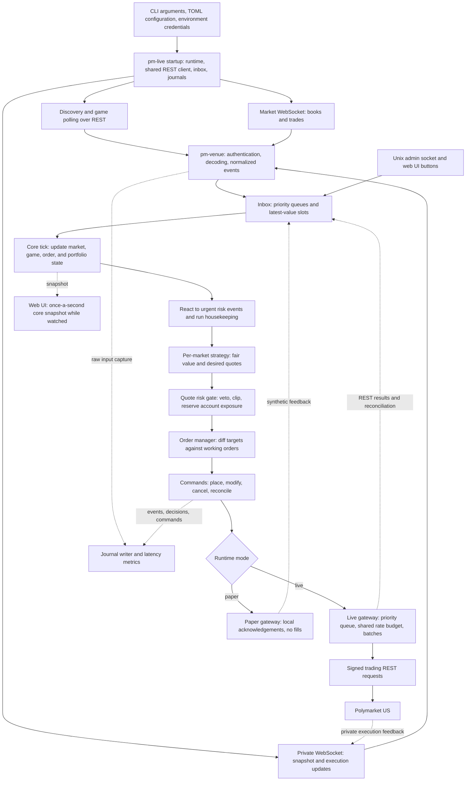

# Repository architecture

This repository connects to the Polymarket US Retail API for darts market discovery, data capture, manual operations, and automated market making. It has two executables: the `pmbot` process and the `pm-backtest` replay tool. `pm-backtest` makes no network calls; it runs the same `pm-core` as `pmbot` against a simulated exchange.

This document describes the implemented live, paper, recording, and backtest paths. Source files are the authority for behavior. Trade-off explanations below describe the consequences of the implementation, rather than assuming undocumented historical motivations.

## Components and dependencies

| Component | Responsibility | Main sources |
| --- | --- | --- |
| `pm-types` | Shared prices, quantities, timestamps, venue enums, normalized input events, and output commands | [Types](../../crates/pm-types/src/lib.rs), [events and commands](../../crates/pm-types/src/event.rs) |
| `pm-venue` | Ed25519 signing, JSON decoding, REST endpoints, rate limiting, signed WebSocket connections and subscription messages | [Venue adapter](../../crates/pm-venue/src/lib.rs) |
| `pm-core` | Synchronous state ownership, market data, game state, strategies, portfolio accounting, risk, order lifecycle, and the read-only operator snapshot | [Core pipeline](../../crates/pm-core/src/core.rs), [snapshot](../../crates/pm-core/src/snapshot.rs) |
| `pm-live` | `pmbot` executable: configuration, asynchronous feeds, inbox, gateway, operator socket and web UI, journals, metrics and input-to-ack timing, watchdog, and shutdown | [Entrypoint](../../crates/pm-live/src/main.rs) |
| `pm-backtest` | `pm-backtest` executable: replays exported history through `pm-core` against a per-market simulated exchange, audits data quality, and writes reports | [Entrypoint](../../crates/pm-backtest/src/main.rs), [simulator](../../crates/pm-backtest/src/sim.rs) |
| `pmus/` | Small Python operator tool on the official `polymarket-us` SDK: account reads, manual orders, cancel-all with verification (also the dead-man Lambda), raw frame recording. Independent of the Rust code | [CLI](../../pmus/__main__.py), [dead-man](../../pmus/deadman.py) |
| `config/` | Example and run configurations for the bot, latency probe, and backtests: market selection, strategy routing, risk, execution, and league formats | [Bot configuration](../../config/pmbot.example.toml), [backtest configuration](../../config/backtest.example.toml) |
| `docs/polymarket-docs/` | Venue protocol notes and observed behavior used by the adapters | [Venue documentation](../polymarket-docs/README.md) |
| `data-analysis/` | Historical-data inspection, load estimation, and the Parquet-to-replay export the backtester reads; outside the running bot | [History inspection](../../data-analysis/inspect_history.py), [load estimation](../../data-analysis/estimate_load.py), [backtest export](../../data-analysis/export_backtest.py) |
| `tests/`, Rust inline tests and crate tests/benches | Protocol fixtures, component checks, pipeline checks, simulator checks, and CPU benchmarks | [fixtures](../../tests/fixtures), [core integration tests](../../crates/pm-core/tests/tick.rs) |

The Rust dependency direction is `pm-live → pm-core + pm-venue + pm-types` and `pm-backtest → pm-core + pm-types`, with `pm-core → pm-types` and `pm-venue → pm-types`. The core does not depend on network adapters, the live runtime, or the simulator (`pm-venue` is only a dev-dependency of `pm-core`, for tests and benches). There is no external database, message broker, or separate strategy service in this execution path.

Each library and the live shell have their own breakdown of modules, public interface, and internal design: [`pm-types`](pm-types.md), [`pm-venue`](pm-venue.md), [`pm-core`](pm-core.md), and [`pm-live`](pm-live.md). This document stays the cross-crate view; the backtester is covered in [Backtesting](#backtesting) below.

## Main flow

The main path runs downward. Dashed edges show feedback and observation paths.

Recording mode stops at ingestion and journaling: it drains the inbox periodically without creating a core or order gateway. The backtester replaces everything above the inbox and below the commands with a simulator; see [Backtesting](#backtesting).

## Process layout and startup

[The live shell](../../crates/pm-live/src/main.rs) loads and validates configuration, resolves credentials, constructs a signer, and starts a two-worker Tokio runtime. Network I/O runs as asynchronous tasks. In paper and live modes, a dedicated OS thread owns the core, while another thread writes journals. When `--ui` is given, the web UI runs on a third OS thread with its own single-threaded Tokio runtime, so it never takes a worker from the feeds or gateway. The shell shares the REST client, rate limiter, inbox, and metrics through reference-counted handles.

| Mode | Inputs | Decision and execution behavior |
| --- | --- | --- |
| `record` | Discovery, game polling, public market stream, private account stream | Capture only; no trading core, gateway, admin server, or web UI (`--ui` is ignored with a warning) |
| `paper` (default) | Real discovery, game polling, and market stream; no private stream | Real core with a local gateway; synthetic empty order snapshot and positions, a $100 balance, and a private-feed-up event; acknowledgements but no fills |
| `live` | Real public and private feeds | Real core and signed trading REST calls; watchdog enabled |

All three modes load credentials because the WebSocket connections are signed. Environment values take precedence over the configured `.env` file. Signing uses Ed25519 over `timestamp_ms + METHOD + path`; credentials are omitted from their Rust debug representation. See [authentication](../../crates/pm-venue/src/auth.rs).

Configuration is parsed once at startup. Unknown TOML keys and invalid strategy references fail validation. Named strategy profiles are selected by ordered routes: all supplied matchers must match, the first matching route wins, and route-specific parameters override the profile. Unmatched markets use `default`. Each market gets its own strategy instance and state. There is no configuration reload command.

## Ingestion and normalized data

[Feed tasks](../../crates/pm-live/src/feeds.rs) own connection management and forward typed events rather than trading directly.

- **Discovery:** queries darts events every five minutes, optionally including futures. It deduplicates markets and publishes metadata plus subscription slugs. Trading modes filter subscriptions by configured market type; record mode does not apply that filter. Failed discovery retains the previous set and retries after 30 seconds. Parameter rejects can request an immediate refresh.
- **Game polling:** queries event state every second during live games, every five seconds near a scheduled start, and otherwise every 30 seconds. Changed states are forwarded; when a latency-probe profile is configured, unchanged responses are also forwarded so real poll receipt can trigger a measured probe order. A separate successful-poll signal keeps unchanged scores from appearing stale.
- **Market stream:** subscribes to full books and trades in groups of at most 100 slugs. Newly discovered slugs are added to an existing connection. Removed subscriptions are not actively pruned until reconnect; the core separately marks removed markets inactive, cancels their orders, and drops their state an hour later once they are flat with no orders.
- **Private stream:** on every connection, subscribes to updates and the open-order snapshot, buffers intervening updates, waits for snapshot completion, then fetches positions and balance over REST. It queues the snapshot, account state, buffered updates, and readiness notification before entering its normal receive loop.

Both WebSocket loops ping every five seconds and reconnect after 15 seconds without incoming traffic. Reconnection uses jittered exponential backoff capped at ten seconds; authentication failures wait 30 seconds. Public books must seed again after a disconnect. Rebuilding private state on reconnect provides recovery without relying on locally persisted trading state.

[Decoding](../../crates/pm-venue/src/decode.rs) isolates venue JSON from the core. Unknown enum values become `Unknown`. Undecodable market frames are logged and dropped. On the private socket, an undecodable frame or a subscription error ends the connection, so the reconnect re-reads the order snapshot and positions instead of silently losing an execution. A field that is present but unreadable is an error, never a zero, and an empty REST snapshot must be an explicit empty container (`"orders": []`, `"positions": {}`, `"events": []`). `ORDER_STATE_REPLACED` is a working order: a modify keeps the id. Prices use the YES-price convention throughout, including orders expressing NO exposure.

[Rust numeric types](../../crates/pm-types/src/num.rs) store both prices and quantities as integers in units of `10^-4`. Wire decimals are parsed from text without first converting to floating point. Timestamps retain integer nanoseconds. Fair values, model calculations, cash, and reporting values use floating point; executable prices and quantities are rounded back to tick and quantity increments. This gives exact order arithmetic at the supported precision while keeping probabilistic calculations straightforward.

## Queueing and core state ownership

[The inbox](../../crates/pm-live/src/inbox.rs) deliberately treats replaceable state differently from events that must be processed individually.

| Input | Storage and drain behavior | Trade-off |
| --- | --- | --- |
| Control and connection events | Unbounded FIFO | Preserves operational transitions, but sustained overload can grow memory |
| Order/account feedback | Separate unbounded FIFO | Preserves lifecycle events and ordering within the queue, with the same memory risk |
| Books | Latest arrival per market | Avoids processing superseded full snapshots, but loses intermediate states |
| Game state | Latest arrival per event | Bounds repeated state work, but can skip intermediate score transitions |
| Public trades | FIFO capped at 10,000; at most 1,000 drained per tick | Bounds work and protects book processing; overflow drops trades and increments a counter |

A capacity-one notification channel coalesces wakeups. The core sleeps until a notification or its next housekeeping deadline, then drains input. It stably sorts events by control, feedback, game, trades, and books. This is priority ordering, not a global exchange-time ordering across feeds.

The core owns mutable trading state on one thread and exposes `Core::tick(Clock, Vec<Event>) → TickOutput`. The supplied clock separates monotonic time for durations from wall time for expiries and UTC-day accounting. Ordered maps and explicit time make behavior reproducible for the same initial state, clocks, and event sequence.

A tick performs these steps:

1. Apply events to market data, games, orders, and portfolio state; collect affected markets and derived events.
2. Run due housekeeping: timeouts, reconciliation scheduling, GTD refresh, loss checks, pruning, and re-deciding markets whose decision changed with time.
3. React to urgent conditions with cancellations, pauses, refresh requests, or account queries.
4. Evaluate affected markets, prioritizing urgent markets, then in-play markets, then slug order.
5. Gate quote targets and reserve exposure before processing the next market.
6. Diff approved targets against working orders and emit commands.
7. Return commands, decisions, derived events, and latency samples to the shell for dispatch and recording.

Housekeeping defaults to 250 ms. It re-decides a market only when that market's strategy reported a time boundary that has now passed (`Strategy::wake_at`, e.g. the scheduled start), a risk block expired, game polling turned stale or recovered, or the UTC day rolled; a full re-decide of every market runs every `redecide_all_s` (5 s) as a backstop, e.g. for account-wide room freed by another market. A single owner simplifies consistent account-wide decisions and avoids locks inside trading state; its cost is that a slow tick delays every market.

## Market state, valuation, and strategies

[Market data](../../crates/pm-core/src/market_data.rs) treats every book message as a complete replacement. Invalid or older books are rejected. Trades are deduplicated and provisionally remove liquidity until a book with a sufficiently recent exchange timestamp incorporates them. Cumulative volume is compared with received trades to detect missing activity. Recent trade IDs and sweep history are bounded.

Before strategy evaluation, the core subtracts its own known resting quantities from the provisional book. This reduces the chance of treating its own quotes as independent market consensus, though the view still depends on timely execution and book updates.

[Game state](../../crates/pm-core/src/game.rs) tracks scores, live/ended status, period changes, and leg transitions per event. Market metadata maps home/away scoring to YES/NO outcomes. A score change makes related markets urgent; in-flight quotes are cancelled when they cannot be safely repriced in that tick.

Strategies implement the [Strategy interface](../../crates/pm-core/src/strategy/mod.rs), consuming a `MarketView` and returning desired bids, asks, fair value, and phase information. The bot only makes markets. The implementations are the [market makers](../../crates/pm-core/src/strategy/spread.rs), `off`, and the operator-run diagnostic [`latency_probe`](../latency-probe.md).

The mid-based market makers take others' mid (our own resting orders excluded) as fair; the VWAP variant uses others' top-three-level book VWAP. All skip markets whose spread is wider than `max_spread`, quote a half-spread either side of fair, round outward to the tick, and stay strictly inside the other side's touch so post-only orders don't cross. An optional inventory cap quotes only the reducing side, and an optional skew moves both quotes against the position:

- `pre_match` quotes until `stop_before_start_s` before the scheduled start, or until the game feed reports the match live.
- `full_match` quotes one width throughout, until the match ends.
- `two_phase` quotes `pre_half_spread` until `widen_before_start_s` before the start, then `live_half_spread` through play.
- `two_phase_vwap` uses the same two-phase timing and quote rules, centred on the size-weighted price of others' best three price levels per side. It also re-decides on deeper book updates. Trading depth stays at 3 independently of the displayed VWAP depth.

None of them reads the score, so in play they are the slow side.

## Portfolio and risk

[Portfolio accounting](../../crates/pm-core/src/portfolio.rs) tracks signed YES exposure, cash, fees, and marked PnL. Own fills update local accounting. Full REST position reports seed or reconcile it; individual private position messages are currently recorded as observations rather than directly replacing local accounting. A detected mismatch pauses the market and requests cancellation.

[Risk](../../crates/pm-core/src/risk.rs) is separate from strategy. Quote eligibility requires an active listing, a seeded open book that isn't stale, a ready private stream, fresh game polling when live, no unresolved order uncertainty, and no applicable pause or loss kill. The venue sends a book only when it changes, so a quiet book is normal; a book counts as stale when a trade has had no book after it for `book_stale_after_trade_s` (10 s; in the 10-28 captures the next book followed every trade within 5 s), or when a live match has had no book for `book_stale_live_s` (90 s; in-play gaps reached 51 s). Housekeeping pulls a stale market's quotes and re-decides it when books resume. Failed score orientation blocks live quoting for the league.

The quote gate checks price validity, sizing, position limits, order counts, buying power when known, and worst-case market/account loss. Loss estimates include resting exposure under YES, NO, and cancellation settlement scenarios. Targets can be clipped to quantity increments or vetoed. Reservations made earlier in a tick count when gating later markets, preventing those markets from independently allocating the same risk budget. Deterministic processing order also means earlier markets can receive scarce capacity first.

The loss limits mark open positions pessimistically: the worse of the strategy's fair and what others would pay to take the position off us now (their best bid for a long, best ask for a short), else the last trade, so a wide or one-sided book shows the loss instead of leaving the position at cost. The daily figure is measured from the first mark after venue positions are seeded, so inherited positions don't count as the day's PnL. `daily_loss_limit` must be below `max_account_loss` (validated).

Reactive controls include daily and market loss limits, fill/reject-rate responses, transient exchange-slow handling, parameter refreshes, and operator pauses. Resting and uncertain orders continue to matter until their outcomes are resolved.

The bot only makes markets: a `Decision` carries a bid and an ask and nothing else, every order is post-only and good-till-date, and there is no IOC path in the core, the gateway or the backtest simulator.

## Order lifecycle and outbound execution

[The order manager](../../crates/pm-core/src/orders.rs) owns one quote slot per market side; every order the core places occupies one. Records without a slot (`quote_side = None`) still count toward order limits and exposure. It translates targets into placements, modifications, cancellations, or no action. Local states are `PendingNew`, `Live`, `PendingReplace`, `PendingCancel`, `InDoubt`, and `Done`.

A successful create REST response can attach a venue order ID, but an HTTP success alone does not establish that an order is live, replaced, or cancelled. Private execution reports drive normal lifecycle transitions; snapshots and explicit REST lookups resolve uncertainty. Execution IDs and cumulative quantities help suppress duplicate accounting.

Because requests lack a venue client-order ID, the manager uses local tokens, returned venue IDs, and matching order fields to correlate feedback. Ambiguous outcomes become `InDoubt` and trigger reconciliation instead of immediate blind resubmission. Unknown venue orders are cancelled and their markets paused. On startup this also means pre-existing orders are not simply adopted as strategy quotes; sharing the account with another order producer can cause cancellations.

[The gateway](../../crates/pm-live/src/gateway.rs) receives commands over an unbounded channel. Its priority queue orders cancel-all, cancellation, inventory reduction, new quotes, refresh, and read work. Queued actions can be withdrawn before dispatch. Compatible create/modify/cancel actions batch up to 20, with an additional rate token consumed per added action. Requests execute asynchronously, so priority governs dispatch, not completion order.

All ordinary Rust REST callers share a [token bucket](../../crates/pm-venue/src/rest.rs) configured at 15 tokens per second, charging each order action even within a batch. Low-priority polling leaves a reserve for order traffic. The configuration flag `[execution].rate_limit_enabled` defaults to true; the latency probe disables proactive throttling to measure its contribution to latency. Actual HTTP 429 responses always impose a shared exponential cooldown. The gateway retries selected rate-limit/transient-limit responses once; authentication errors, classified rejections, and ambiguous failures return distinct feedback. Per-action charging is a conservative local choice, not an established venue batch quota rule. See [venue rate limits](../polymarket-docs/polymarket-connectivity.md#8-rate-limits-and-request-budget) and [the rate limiter](pm-venue.md#rate-limiter).

Orders use explicit good-till-date expiry, periodically refreshed. Expiry limits how long abandoned quotes can remain at the venue, at the cost of refresh traffic. The gateway is the normal trading REST path, with deliberate exceptions for direct watchdog and shutdown cancellation.

## Recovery, operations, and persistence

Market-stream loss unseeds books and requests market cancellations. Private-stream loss marks orders uncertain and requests account-wide cancellation. Reconnect restores snapshots and account state before normal decision-making resumes. Periodic REST reads cross-check positions and balance, while order timeouts schedule order lookups or open-order reconciliation.

In live mode, the watchdog checks every 500 ms. If the core heartbeat is older than two seconds **and the inbox has pending work**, or the core thread has ended, it blocks new and changed orders and runs cancel-all over REST, checked with an open-orders read, retrying with backoff (1 s to 30 s) until confirmed; sending resumes if the core recovers. It runs on its own OS thread with its own single-threaded Tokio runtime and its own HTTP client (connection pool and 429 backoff), so a stuck main runtime or a wedged connection doesn't stop it. It still shares the process, so a crash or a dead machine leaves only GTD expiry.

Ctrl-C, SIGTERM, SIGHUP, the web UI's shutdown button, or the core thread ending all stop new orders, wait up to two seconds for creates and modifies already sent, queue a core cancel-all and, in live mode, run REST cancel-all checked with an open-orders read (up to three rounds). The exit code is non-zero if that check fails.

[The Unix admin socket](../../crates/pm-live/src/admin.rs), normally `run/pmbot.sock`, accepts `status`, `metrics`, `pause [slug]`, `resume [slug]`, and `cancel-all`. Mutating commands enter the control queue; `ok` means queued, not executed. Cancel-all also leaves the bot paused until resumed. Local socket access supplies the operator boundary. The socket stays the scriptable interface.

[The operator web UI](../../crates/pm-live/src/ui.rs) is off unless `--ui <addr>` is given. It is a server-rendered HTMX page, plus a `/metrics` page and JSON endpoints (`/snapshot.json`, `/metrics.json`). It never touches `Core`. The core thread builds a [`Snapshot`](../../crates/pm-core/src/snapshot.rs) at most once a second, after that tick's commands are dispatched, and only while a page has polled in the last five seconds. The snapshot holds account health, current PnL (venue mid when the spread is at most 10¢) and expected PnL (strategy fair), daily PnL, worst-case loss, and per-market books, positions, and resting orders. The metrics page reads the lock-free `Metrics` histograms directly, so viewing it does not cause snapshots to be built.

The UI's buttons are pause/resume (for all markets or one market), cancel-all, and shutdown. Pause, resume, and cancel-all post `AdminCmd`s to the same control queue as the socket. Shutdown notifies the main thread. The UI cannot place orders or change limits. Every POST must carry a per-process random token embedded in the page, and must have a same-origin `Origin` when the browser sends one. Binding a non-loopback address requires `--ui-allow-remote`. There is no user authentication, so the UI is intended for local or tunnelled access only.

[Journals](../../crates/pm-live/src/journal.rs) append JSONL files under `captures/` by stream and UTC date:

| Stream | Contents |
| --- | --- |
| `<date>.jsonl` | Raw market frames with connection, receive time, and monotonic time |
| `private-<date>.jsonl` | Raw private frames |
| `discovery-<date>.jsonl`, `game-<date>.jsonl` | Market metadata and changed game state |
| `core-<date>.jsonl` | Input events, commands, decisions, and derived events for ticks with input or commands |
| `metrics-<date>.jsonl` | Periodic latency summaries |

Core commands are dispatched before journal serialization. The journal thread has a 100,000-entry bounded queue and drops/counts submissions when full. Buffered writes and detached shutdown mean journals are diagnostic artifacts, not a durable transaction log or guaranteed crash-recovery checkpoint. Trading state lives in memory and startup recovery relies on the venue, except for the risk state file (`--risk-state`, default `run/risk-state-<mode>.json`, `none` to disable): the daily kill, the day's PnL, per-market losses towards `market_loss_limit`, and indefinite market pauses. The core thread offers it after any alert or admin command and once a second; a separate thread writes it (temp file, then rename), and shutdown writes it last. At startup the day's PnL and kill are restored if it is still that UTC day, market losses if saved that day or the day before, and indefinite pauses always (an operator `resume` clears them). An unreadable file stops startup rather than silently clearing the limits. Journaling can be disabled with `--journal-dir none`.

[Metrics](../../crates/pm-live/src/metrics.rs) cover venue-to-receive lag, WebSocket RTT, inbox delay, core tick/busy time, decision latency, gateway wait, REST round trips, and acknowledgement latency. [Input timing](../../crates/pm-live/src/timing.rs) adds two end-to-end stages, `input_to_send` and `input_to_ack`. Each place, modify, or cancel command is attributed to the oldest book, trade, or game input in the same tick for the same market. Refresh modifies and commands without a same-market input are not attributed. The input-to-ack stage closes when the core sees the matching create/modify acknowledgement, in live mode only. Window summaries are logged every 60 seconds; the admin socket and UI report since-start metrics, and the UI also shows the last 60 one-minute windows. Initial book snapshots are excluded from book-lag measurements, and exchange-to-local measurements still include clock offset. See [the metrics reference](../metrics.md).

## Backtesting

[`pm-backtest`](../../crates/pm-backtest/src/main.rs) replays history through the core against a simulated exchange. `data-analysis/export_backtest.py` converts the Parquet history into `data-analysis/backtest/`: a `markets.json` manifest plus one replay-ordered CSV of FIX rows per market ([loader](../../crates/pm-backtest/src/data.rs)). `audit` rebuilds every [L3 book](../../crates/pm-backtest/src/book.rs) without trading and reports data quality. Markets whose trades agree with the rebuilt book less than `--min-agreement` (default 0.99) of the time are excluded. `run` takes the same TOML configuration as `pmbot`; `--strategy` forces named profiles onto every market, or `config` keeps the configured routes. Every strategy × fill model × latency multiplier combination is one variant.

[The simulator](../../crates/pm-backtest/src/sim.rs) runs one `Core` per market on a single exchange-time timeline, from which the core's monotonic clock is derived. The core sees what the live bot would: L2 books and trades delayed by sampled feed lag, REST results and executions delayed by sampled order latency, and synthetic game polls (live from the scheduled start; disable with `--no-game-state`). Fill models are `optimistic` (trade at our price after the queue ahead is used up), `base` (orders joining our level within a tie window count as ahead), and `pessimistic` (only a trade through our price, or a crossing order, fills us). Our fills never change the historical book. Runs are deterministic for a given seed, and markets run in parallel threads.

Markets are simulated independently, each with its own balance and rate limiter, so summed results are not a concurrent portfolio simulation. Data is split chronologically into `dev` and `holdout` around the August–September gap. [Reports](../../crates/pm-backtest/src/report.rs) write `sweep.csv` and, per variant, `summary.json`, `markets.csv`, and `fills.csv` under `backtests/`. The [metrics reference](../metrics.md) defines each field.

## Testing and extension points

The core's explicit inputs and outputs support focused pipeline testing without sockets, and let the backtester drive the same code as the live bot. Existing tests cover numeric parsing, authentication/protocol behavior, books, strategies, risk, order transitions, inbox behavior, input timing, admin and UI routes, core ticks, and simulator fills. Criterion benches measure core ticks, core components, and venue decoding/signing. Changes to a strategy belong behind the strategy interface and configuration variant; venue wire-format changes belong in adapters and shared normalized types; new I/O sources should feed typed events through the shell rather than mutate core state directly.
