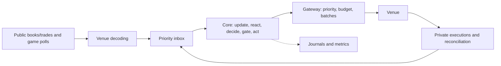

# System design, trading mechanics, and evidence

This review assesses the repository at `7caae31`, using the current code, configuration, saved experiments, and local captures available on October 28, 2026. My assessment is that the deterministic core and order lifecycle provide a useful foundation for a small market-making experiment. The evidence does not yet establish a durable trading edge or justify increasing size. I would first address decisions made on stale market data and improve the evaluation dataset; those findings have a more direct connection to observed losses than further CPU optimization.

I distinguish checks performed for this review from earlier research below. Statements about design intent are my interpretation of the implementation, rather than claims about why every original decision was made.

**System design.** The main architectural choice is a synchronous, deterministic trading core surrounded by asynchronous I/O. [`pm-core`](../crates/pm-core/src/core.rs) accepts an explicit clock and typed events and emits commands. It owns market state, strategies, positions, risk, and order state. [`pm-venue`](../crates/pm-venue/src/lib.rs) handles the protocol, while [`pm-live`](architecture/pm-live.md) handles connections, scheduling, journals, operations, and execution. [`pm-backtest`](../crates/pm-backtest/src/sim.rs) runs the same core against a simulated exchange.



One thread owns trading state. That makes account reservations and order transitions easier to reason about: two markets cannot independently allocate the same available capital in one tick. Ordered iteration and an injected clock support reproducible tests. The trade-off is that one busy market or expensive strategy can delay the others. Shared strategy code also leaves room for differences between live execution and simulation; identical decisions do not imply identical fills.

The [`inbox`](../crates/pm-live/src/inbox.rs) treats full books as replaceable state and executions as events. It keeps the latest book per market and game frame per event, preserves feedback in an unbounded queue, and bounds trades at 10,000, draining at most 1,000 per tick. Conflating full books limits obsolete work; conflating executions would corrupt positions. Conversely, feedback can exhaust memory if the consumer stalls, and trade overflow loses information. Those are operational conditions to measure and act on. Journaling runs separately and can drop records rather than block trading, which protects latency but means a journal is not a guaranteed complete audit trail.

I would retain this process layout until concurrent in-play captures show sustained queue pressure. The historical [load study](../data-analysis/README.md#results-from-this-export) observed a peak of 764 FIX match-market rows in an aligned second and proposed 3× headroom, or 2,292 rows/s. That is a sizing scenario. This export contains no WebSocket match-market history, so it does not establish the live service's capacity. The [worker design](potential-improvements/input-queue-and-workers.md) remains a proposal; adopting it would require versioned proposals and a coordinator that still owns account risk.

**Market mechanics and pricing.** This is the Polymarket **US Retail API**. Prices refer to one YES instrument: buying NO at $0.40 is equivalent to selling YES at $0.60. The implementation uses signed YES inventory throughout, avoiding separate exposure ledgers for economically equivalent orders. This matches the venue's [order model](https://docs.polymarket.us/concepts/orders).

A long contract bought at price `p` can lose `p`; a short opened at `p` can lose `1 − p`. The venue collateralizes executed contracts fully, but checks resting orders per instrument. Orders across several instruments can therefore rely on the same buying power, and fills can trigger unsolicited cancellations elsewhere. The bot deliberately reserves capital across markets itself. That reduces how much liquidity it can display, while reducing dependence on venue auto-cancellation. See the venue's [collateral rules](https://docs.polymarket.us/market-structure/collateral-and-margin) and the local [protocol notes](polymarket-docs/trading.md).

The current [`two_phase` live configuration](../config/pmbot-two-phase-live.toml) uses this approximate rule, before tick rounding, price bands, and post-only constraints:

```text
f      = midpoint of other participants' best bid and ask
center = f − 0.01 × signed YES inventory
bid    = center − h
ask    = center + h
h      = $0.10, increasing to $0.15 from 900 seconds before scheduled start
```

It requests one contract per side and suppresses the inventory-increasing side once absolute inventory reaches four contracts. This is a strategy threshold, rather than a guarantee that a fill cannot take inventory past four. It requires a two-sided others' book with spread no wider than $0.40. The spread parameters are **half-spreads**: ±$0.10 is a $0.20 quoted width before adjustments. Bids round down, asks round up, and neither crosses the opposite touch. These behaviors are implemented in [`spread.rs`](../crates/pm-core/src/strategy/spread.rs).

The central assumption is that others' midpoint is a useful reference and that enough uninformed flow will reach distant quotes to compensate for adverse selection and inventory exposure. A midpoint is not an independently calibrated win probability. In a thin market, another participant's one-contract order can move it substantially. Removing our own orders avoids direct feedback from our quotes into our fair value. The current core also accounts for acknowledged order changes that the public book has not yet shown; without that temporal adjustment, our old quote can be mistaken for somebody else's liquidity.

`two_phase_vwap` instead uses a size-weighted average across the best three price levels on each side, after removing our orders. This is a book statistic, rather than the VWAP of executed trades or the microprice formula. It uses more depth but is sensitive to displayed size and stale levels. A better-looking book statistic needs to earn its place through execution results.

I would evaluate a quote by expected value **conditional on its filling**. For a bid, the relevant term is `E[future value | our bid fills] − bid`, less fees and inventory costs. For an ask it is `ask − E[future value | our ask fills]`. A large distance from the current midpoint can still lose money if informed traders select exactly the quotes about to become wrong. Positive spread capture and profitable settlement inventory should therefore be reported separately.

Normal strategies submit post-only GTD orders. The simulator assumes zero maker fees and no rewards. For ordinary contracts, the published taker fee is `Θ × contracts × p × (1 − p)`, with cent rounding; the market supplies its coefficient. Tier 1 has no maker rebate. Any future aggressive liquidation or taker strategy needs its own fee and slippage model. I would not assume incentive income or a higher rebate tier in the business case. These assumptions were checked against the [current fee schedule](https://docs.polymarket.us/fees).

There is no implemented score-based fair-value model in the current strategy set. Game state provides safety and timing information, while league-format configuration is reserved for future modeling. A proposed model would need correct YES/player mapping, match format, throw order assumptions, and calibration at the time a decision is made. A probability model fitted using a later settled book cannot be treated as an available live signal.

**Data quality and what the backtest can establish.** The [dataset inspection](../data-analysis/README.md) records 5,120,735 rows. Metadata describes 1,405 markets, but only 435 have market data: 308 match-winner markets and 127 futures. The backtest filters to 242 match markets with trades. Metadata coverage, tradable coverage, and the evaluated sample are different denominators.

For this review I rebuilt and ran the current audit against the existing export:

| Check | Result |
| --- | ---: |
| Traded markets audited / excluded by the 99% agreement gate | 242 / 0 |
| Reconstructed messages | 2,028,629 |
| Trades present at a resting book level / trades checked | 13,365 / 13,365 |
| Crossed reconstructed books | 0 |
| Within-session snapshot mismatches / mismatches at the touch | 36 / 20 |
| Snapshots after sequence reset | 641 |
| Changes referencing an unknown order | 3 |
| Per-market inter-message gaps longer than 60 seconds | 46,371 |

The agreement check establishes a useful local consistency property. It does not establish continuous capture or correct queue placement. The gap count also cannot distinguish quiet trading from missing capture.

The earlier [data-quality investigation](potential-improvements/backtest-data-quality-2026-10-28.md) supplies the continuity analysis that this audit lacks. It found 85 mid-stream reconnects with a median preceding venue-wide silence of roughly 370 seconds. Within a session, 36 of 118 re-snapshots differed from reconstruction. The development sample contains 71 traded markets, versus 171 in the later sample; only 48% of development markets have a trade after scheduled start, versus 91% later. In 24 development markets, the last captured trade lies on the opposite side of $0.50 from the eventual binary outcome. That is evidence of incomplete observed play, not proof that settlement is wrong. I verified the current audit totals above; I did not repeat that investigation's independent Parquet scans.

These observations change how I interpret performance. Reconstructed liquidity may be stale during outages, and inventory may be carried to settlement through an unobserved match. A gate that passes every market cannot control those problems. I would classify continuous segments, save named exclusion reasons and coverage statistics, invalidate trading state across known outages, and require a new snapshot before resuming. Offline identification of an outage can define an evaluation exclusion; a realistic replay must use the timeout or disconnect information available at that instant, without future knowledge of the reconnect.

The simulator has explicit queue, partial-fill, cancel-race, latency, and GTD behavior. Its base model penalizes near-simultaneous arrivals; its pessimistic model fills on trades through the quote or historical orders crossing it. Both retain the same historical flow after our hypothetical fills. That no-impact assumption becomes less credible as our size approaches available flow. Agreement between these models tests one source of uncertainty; it does not bound all execution error.

Defaults of 63 ms book lag, 54 ms trade lag, and 20 ms one-way order latency are simulation inputs. Their lognormal distribution shapes and symmetric order paths are assumptions. Real score history is absent from the exported replay: game state becomes live synthetically at scheduled start. This cannot validate a score-aware strategy. Markets also replay independently, each with $1,000 and its own core and limiter, so aggregate results do not test simultaneous account funding or shared request contention.

For example, the committed [midpoint versus depth-VWAP experiment](../data-analysis/vwap-strategy-results.json) contains these saved results at latency multiplier 1:

| Center / fill model | Settlement PnL | Fill events | Order actions | +60 s markout per contract |
| --- | ---: | ---: | ---: | ---: |
| Midpoint / base | +$61.68 | 1,563 | 1,721,650 | +5.11¢ |
| Midpoint / pessimistic | +$61.21 | 1,552 | 1,714,324 | +5.11¢ |
| Three-level VWAP / base | −$58.42 | 2,408 | 16,788,157 | −1.36¢ |
| Three-level VWAP / pessimistic | −$58.53 | 2,411 | 16,688,983 | −1.39¢ |

These are earlier results at revision `15bad8b`, with source fingerprints and configuration preserved in the artifact; they are not a rerun of the current code. Each variant includes 242 markets, with settlement PnL available for 230, and proactive throttling disabled. “Order actions” are simulated place/modify/cancel/cancel-all dispatches, not live HTTP requests. The midpoint base result decomposes into $12.53 spread attribution and $49.14 inventory attribution. I read that as a reason to inspect inventory dependence and execution churn, rather than evidence of $61.68 in repeatable spread income. The [order-timing diagnosis](../data-analysis/vwap-order-diagnosis.json) further investigates the feedback behind excess traffic.

The [metrics definitions](metrics.md) impose other limits: group drawdown is the largest individual-market drawdown, not portfolio drawdown; markouts can reuse an old midpoint beyond capture coverage; and bootstrap intervals resample markets without modeling their dependence or parameter selection. Multiple strategies have already been evaluated on the nominal holdout. A new forward collection period is needed for an untouched evaluation.

**Latency and execution.** I measure latency at separate boundaries because each suggests a different intervention: venue timestamp to receipt, receipt to decision, gateway wait, HTTP dispatch, and receipt to a matched private acknowledgement. Venue-to-local lag includes clock offset. `input_to_send` ends at HTTP-client dispatch, before instrumented wire transmission or public-book visibility. `input_to_ack` ends when the core processes a correlated private New/Replace acknowledgement. Its origin is the oldest surviving same-market input in that tick, which is batch attribution rather than proof of a single causal event.

For this review I aggregated the 46 saved probe windows in `captures/latency-probe/metrics-2026-10-28.jsonl`, whose window-end timestamps span 01:30:17–02:25:08 UTC. All report local throttling disabled and a zero HTTP-429 counter. These are recorded windows with gaps, not proof of uninterrupted operation. Weighting each mean by its sample count gives 1.014 ms for input-to-send across 10,557 samples and 114.383 ms for input-to-ack across 10,177 samples; the largest observed acknowledgement interval is 1,589.712 ms.

The final 60-second window, ending at 02:25:08.444958 UTC, gives a concrete view of the distributions:

| Stage | Samples | Mean, ms | p50, ms | p99, ms |
| --- | ---: | ---: | ---: | ---: |
| Core tick | 643 | 0.160 | 0.085 | 2.438 |
| Input to HTTP-client dispatch | 188 | 0.861 | 0.563 | 9.681 |
| Input to private acknowledgement | 180 | 89.152 | 83.480 | 225.604 |

Percentiles are approximate histogram values. I did not average window percentiles to create a session p99. Send and acknowledgement populations differ because some commands do not produce a matching acknowledgement sample; that difference alone is not a failure rate. Successful acknowledgement latency also omits unresolved failures, and these probe orders are distant quotes rather than a controlled sample of competitive in-play orders. Negative book-lag samples in the same capture reinforce why cross-clock lag cannot be interpreted directly as one-way network delay.

The current live config disables the normal 15-action/s proactive limiter and sets `core_spin_us = 1000000`, keeping one CPU busy to avoid sleeping. Those are explicit latency experiments with capacity and operational costs. The records above do not isolate either flag's causal benefit. I would compare matched runs using tail latency, CPU utilization, quote age, cancellation completion, reject rate, and markout. Zero observed 429s in one capture does not establish safe unbounded sending. The earlier [HTTP/3 experiment](potential-improvements/http3.md) likewise found no median advantage and a worse single-request tail, supporting the decision to keep the current transport.

The [`order manager`](../crates/pm-core/src/orders.rs) distinguishes pending, live, replacing, cancelling, and uncertain orders. A REST response supplies correlation information; private execution reports establish normal order outcomes, with snapshots and lookups used for recovery. Acknowledgements that arrive before REST IDs are parked, fills are deduplicated, and ambiguous creates are reconciled rather than blindly repeated. The API's lack of a client order ID makes that caution necessary. Private-stream reconnect includes an order snapshot and account reads because the stream has no gap replay.

The gateway prioritizes cancellation and risk reduction, batches up to 20 compatible actions, and retries selected explicit transient responses once. Priority controls dispatch, not completion, and cannot retract a request already sent. Two-tick repricing hysteresis reduces churn and preserves queue time at the cost of retaining a price slightly away from the latest target. Neither post-only nor fast local dispatch protects a resting order from informed flow.

The strongest execution evidence is the earlier [in-play leg study](potential-improvements/strat-improvements/in-play-leg-study-2026-10-28/in-play-leg-study-2026-10-28.md): 27 MODUS matches over two days, with roughly 118 usable leg changes. The score stamp was observed about 0.61 seconds late at the median, and 66% of the first moves of at least 2¢ toward the leg winner occurred before the stamp. The score feed therefore showed more promise as a defensive input than as a speed advantage. Its reported live in-play fills had a −$1.83 markout over 10.8 contracts at +60 seconds, approximately −17¢ per contract. This is a small-sample markout, not settled account PnL.

In two traced cases, our private fill arrived 11–19 ms before public trades. The core immediately replaced the filled quote against a stale book; the replacement filled 1–8 ms after its acknowledgement. The two repeat fills contributed about $0.46 of negative +60-second markout. The current spread strategies still ignore `MarketView.filled`, and an empty order slot can place immediately, so the relevant protection remains absent. Faster resubmission can amplify this loss mechanism.

**Risk and operational assumptions.** The risk gate is separate from strategy sizing. It checks ticks, price bounds, deviation from fair, book bands, order count, position size, worst-case loss, and funding. Worst-case loss evaluates no fills, all bids filling, and all asks filling against settlement values 0, 0.5, and 1, including recorded fees. Account reservations retain active exposure, including pending modifications, while later markets are evaluated. This is a defensible control for binary contracts, provided position, order, and cost state are complete.

The current live configuration sets these boundaries:

| Control | Value |
| --- | ---: |
| Strategy inventory threshold / risk net-position cap | 4 / 8 contracts per market |
| Requested quote size / maximum order size | 1 / 2 contracts |
| Maximum active orders | 40 |
| Worst-case market / account loss budget | $6 / $30 |
| Marked daily loss stop / market loss stop | $15 / $2 |

The dollar budgets and marked loss stops answer different questions. A stop detected during housekeeping initiates cancellation; it cannot guarantee realized losses stay below its threshold while prices jump or fills race with cancellation. Risk-reducing quotes remain passive and may never execute. The system's emergency action cancels orders and stops quoting; it does **not** automatically liquidate existing inventory.

Defenses include feed-readiness checks, stale-data checks, uncertain-order pauses, fill/reject limits, persistent daily and market loss state, a separate-thread watchdog, verified shutdown cancellation, and GTD expiry. The watchdog acts when the core exits or its heartbeat is over two seconds old with input pending. It has its own runtime and HTTP client, but still shares the process and host. The Python dead-man implementation offers an external cancellation path; the repo alone does not prove that an independent deployment is active. Full-host failure still requires working venue expiry or an independently running canceller.

I would not describe the current limits as fully proven. The [risk notes](risk.md#known-gaps) identify checks that compare only the target quote slots for position limits and self-crossing, missing-cost startup positions valued at $0.50, and a fat-finger band centered on the strategy's own fair. Account worst-case accounting is broader than those particular checks. Per-event exposure is also absent. Conservative account summation avoids assuming diversification, but does not allocate capital intelligently across correlated matches or participants. Persistence covers loss controls, not a fully durable execution ledger; tests and restart reconciliation must establish the practical recovery guarantees.

**How I would improve it.** I would make the following changes in this order, with an observable condition for accepting each one:

1. **Prevent the observed stale-book refill.** Record fill side and time, and block new or more aggressive quotes on that side until public data has demonstrably caught up. If a timeout expires without confirmation, pull and resync rather than assume freshness. Allow cancellations immediately. Add a deterministic fill-before-trade scenario and replay both documented incidents; acceptance requires no immediate same-side replacement against the known stale view. A subsequent strategy cooldown can address informed flow that continues after the book catches up.

2. **Use actual live state to select in-play protection.** `TwoPhase::decide` still chooses width from scheduled time alone. The current 900-second buffer helps with early starts but cannot guarantee the phase is correct. Select the wider width as soon as the game reports live, handle corrections explicitly, and test early starts. Then evaluate post-leg pauses, book-jump pulls, and late-leg widening on newly captured games. The observed leg clock is specific to a small MODUS sample; fit it by league before transferring it.

3. **Make incomplete evaluation data visible.** Persist quality and coverage records with every run, separate pre-match, in-play, truncated, void, and unsettled samples, invalidate state across known capture breaks, and require fresh observations for horizon markouts. Report eligible and excluded counts with reasons, plus markout coverage and age. Use one canonical replay interpretation for research and Rust simulation. Acceptance means no headline result silently includes an unobserved horizon or fills through a known capture outage.

4. **Test account and recovery invariants under adversarial event order.** Extend the existing tests with partial fills during cancel/modify, reconnect gaps, lost REST responses, malformed feedback, restarts with pending orders, missing cost basis, and several simultaneous markets. Apply position and self-cross checks to all potentially live orders. Property tests should assert that a newly approved command cannot increase possible exposure beyond its budget; separate tests should measure overshoot when existing fills race a kill. Use a concurrent portfolio replay with one funding pool and limiter before claiming account drawdown or deployable capacity.

5. **Measure execution quality alongside speed.** Add cancel-request-to-confirmation, decision-to-public-visibility where correlation is possible, quote age, request amplification, failed and unresolved action counts, dropped inputs, and journal failures. Export histograms or raw samples that support aggregation, with run configuration and revision. Refit simulator latency from representative in-play traffic, including correlated tail delays and failures. Accept latency changes only when the reduction survives an A/B comparison and does not worsen adverse selection or operational reliability.

6. **Earn a pricing improvement on forward data.** Compare midpoint, depth-derived centers, and a score-conditioned skew at identical risk and execution settings. Keep size small, freeze parameters before a new collection period, split by match/date, and report PnL attribution, fresh markouts, inventory, request cost, and uncertainty. If adding a score probability model, measure calibration and predictive loss against a book baseline as well as trading PnL. Increase capital only after forward results remain acceptable under conservative fill, latency, fee, and concurrent-funding assumptions.

**Verification and reproduction.** During this review, `cargo test --workspace --offline` passed 140 tests with four ignored; `venv/bin/python -m unittest discover -s data-analysis -p 'test_*.py'` passed all five Python tests. These checks cover real lifecycle and accounting scenarios but do not execute the full proposed stress plan. I submitted no live orders and did not rerun strategy sweeps, the leg study, or transport benchmarks.

The audit can be reproduced from the existing local export with:

```sh
cargo run --offline -p pm-backtest -- audit --split all --threads 2
```

The export manifest records source SHA-256 `04820fd4723b76ccde2a76a34fd4633dd193fe34d0e9f585b7de97a3d26abfca`. The latency aggregation used saved resetting-window records, computing `sum(n × mean_ms) / sum(n)` separately for each stage; the percentile table copies only the final window. Captures and exported replay files are gitignored and must be retained separately to reproduce those measurements. The committed experiment JSON and dated investigations preserve the earlier evidence and its limitations. Future runs should retain the raw-data hash, exact configuration, code revision, full quality report, and measurement boundaries together.
