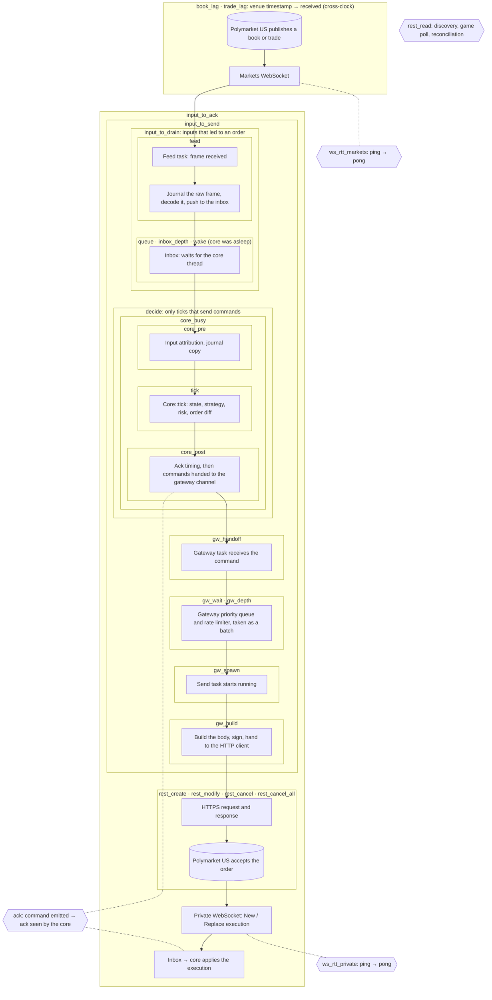

# Metrics reference

The repository measures strategy performance, simulated execution, historical-data quality, and live runtime latency. These are separate measurement systems: a backtest does not measure real WebSocket latency or production uptime. See [architecture](architecture/architecture.md) for the live pipeline.

## Backtest artifacts and aggregation

`pm-backtest run` writes `sweep.csv` and, for each strategy/fill-model/latency variant, `summary.json`, `markets.csv`, and `fills.csv`. [Report generation](../crates/pm-backtest/src/report.rs) defines their contents. `summary.json` includes overall, league, and chronological-split groups plus configuration, simulation assumptions, seed, source checksum, code revision when available, and exclusions.

Markets simulate independently with separate cores, balances, and rate limiters. Summing their PnL is useful for comparison but is not a concurrent portfolio simulation. Group maximum drawdown is the **largest individual market drawdown**, not portfolio drawdown; group peak request rate is likewise a maximum across markets, not simultaneous account traffic.

### Performance and fill metrics

| Metric | Definition and units | Availability / interpretation |
| --- | --- | --- |
| `markets` | Number of non-excluded markets | Summary groups |
| `markets_with_pnl` | Markets with known settlement and computed PnL | Summary; this is the `markets` column in `sweep.csv` |
| `pnl` | Settlement cash plus signed position × settlement, USD | Only markets with settlement contribute; includes fees |
| `pnl_ci95` / `ci_lo`, `ci_hi` | 2.5th and 97.5th percentiles of 2,000 bootstrap sums, resampling market PnLs with replacement | Seeded uncertainty estimate for this sample; does not model cross-market dependence, execution-model error, or parameter selection |
| `pnl_per_market` | Total PnL divided by markets with PnL, USD | Summary |
| `spread` | Sum of side-signed `(mid_at_fill − fill_price) × quantity`, USD | Missing fill mid falls back to fill price, giving zero spread contribution |
| `inventory` | Sum of side-signed `(settlement − mid_at_fill) × quantity`, USD | With the missing-mid fallback, that fill's gross result is attributed to inventory |
| `fees` | Simulated execution fees, USD | Group PnL decomposition includes settled markets only |
| `fills` | Number of simulated fill events | Not unique orders or contracts |
| `contracts` | Sum of filled quantities, contracts | Both buys and sells contribute |
| `mo_1s`, `mo_10s`, `mo_60s` | Quantity-weighted side-signed `(future_mid − fill_price)`, USD/contract | Positive favors the bot; excludes fills without a usable horizon mid; not fee-adjusted |
| `mo_settle` | Quantity-weighted side-signed `(settlement − fill_price)`, USD/contract | Excludes unknown settlement; not fee-adjusted |
| `fills_by_how` | Counts for `queue`, `through`, `cross` | Queue depletion, trade through quote, or historical order crossing quote |

For settled markets, `pnl = spread + inventory − fees`. The decomposition is an accounting attribution, not proof that spread capture is independent of inventory risk.

Markouts use the last historical mid at or before each horizon, with no explicit maximum age. A usable mid requires two sides and spread at most $0.10. Near the end of data, the last available mid can carry forward beyond the observed period; horizon labels do not guarantee a fresh observation. Summary markout denominators can differ by horizon. `fills.csv` makes missing values and per-fill quantities available for coverage checks.

### Execution, inventory, and activity metrics

| Metric | Definition | Output |
| --- | --- | --- |
| `order_requests` | Place, modify, cancel, and cancel-all requests dispatched | Summary and market CSV |
| `read_requests` | Position, balance, open-order, and order-lookup requests | Summary and market CSV |
| `req_per_s_max` | Maximum dispatched requests in an aligned simulated second, including reads | Market CSV; maximum across markets in summary |
| `rate_limited_s` | Distinct simulated seconds with queued requests left waiting for rate capacity; always 0 when the config sets `[execution].rate_limit_enabled = false` | Market CSV; sum of market-seconds in summary, not distinct wall seconds or HTTP 429 count |
| `uptime_bid`, `uptime_ask` | Fraction of replay time with at least one simulated resting order on the side | Market CSV; fraction of the full replay span, not only eligible quoting time |
| `mean_uptime` | Equal-market mean of `(uptime_bid + uptime_ask) / 2` | Summary; not a duration-weighted average or process availability |
| `max_abs_inventory` | Largest absolute net position, contracts | Market CSV |
| `inventory_at_start` | Signed position when the simulated timeline crosses scheduled start | Market CSV; blank if not observed |
| `max_drawdown` | Largest peak-to-trough decline in marked cash plus position, USD | Market CSV; maximum individual-market value in summary |
| `replay_hours` | Duration of each market's simulated timeline, hours | Market CSV; summing gives market-hours, not elapsed calendar time |
| `command_hash` | Hash of timestamped commands in a market run | Market CSV; useful for same-build reproducibility checks, not a performance score |
| `rejects` | Count of simulated rejected orders | Aggregate count in summary |

[The simulator](../crates/pm-backtest/src/sim.rs) also computes `ticks`, `books_sent`, `req_per_s_p50`, `req_per_s_p99`, `twa_abs_inventory`, and a reject-reason map. **The current CLI does not export these fields.** Request percentiles use nonempty request seconds; time-weighted inventory integrates absolute position over the replay duration. These cannot be recovered exactly from the existing CSV summaries, so they should not be presented as measured report values. Group exports retain only the summed reject count.

Each fill row additionally records `slug`, `t_ns` (exchange-timeline nanoseconds), `side`, `px`, `qty`, `fee`, `how`, `queue_ahead` (contracts), `mid`, and its four markouts. Market rows also carry league, split, settlement, exclusion reason, and trade agreement.

### Simulation assumptions

Defaults are book/trade feed-lag medians of 63/54 ms, order one-way median 20 ms, lognormal sigmas 0.5 for feeds and 0.3 for orders, rate/burst capacity 15, $1,000 initial balance per market, and 20 levels of book depth. `--lag` scales sampled latencies; these are input assumptions, not latency results. Our orders are post-only, so simulated fills pay no fee.

`base` assumes orders arriving at the same price within 1 ms are ahead of the bot. `pessimistic` requires a trade through the quote or an incoming historical order crossing it. `optimistic` permits fills once the queue ahead at the price is consumed without the base model's tie penalty. All models assume the bot's executions do not change historical flow.

Game state is synthetic: it becomes live at scheduled start with no real score history. Results cannot validate the score-driven darts model. Development data precedes August 20, 2026; holdout starts September 29, 2026. Markets without trades are filtered out before simulation, and trade agreement defaults to a minimum of 99%.

## Historical-data quality

`pm-backtest audit` prints per-market results and overall counts from [book reconstruction](../crates/pm-backtest/src/book.rs).

| Metric | Meaning |
| --- | --- |
| `messages` | Reconstructed source-message count |
| `snapshots` | Snapshot messages processed |
| `trades` | Trade records checked |
| `trades_at_book` | Trades with resting liquidity at the trade price on the passive side when the message began |
| `trades_no_aggressor` | Trades without usable aggressor direction |
| `trade_agreement` | `trades_at_book / (trades − trades_no_aggressor)`; returns 1 when denominator is zero |
| `snapshot_mismatches` | Within-session re-snapshots whose L2 book differs from reconstruction |
| `snapshot_touch_mismatches` | Such re-snapshots with a differing best price or quantity |
| `snapshots_after_reset` | Re-snapshots following a message-sequence reset |
| `crossed` | Messages leaving a crossed reconstructed book |
| `unknown_changes` | Changes referencing unknown book entries |
| `gaps_over_60s` | Inter-message gaps exceeding 60 seconds; inactivity and missing capture are not distinguished |

Perfect trade agreement does not establish complete capture or correct simulated queue placement. Audit totals include excluded markets; performance groups omit them.

## Live latency telemetry

[The live metrics implementation](../crates/pm-live/src/metrics.rs) maintains 27 stage histograms (25 latencies and 2 queue lengths), each with since-start and resetting windows. Every 60 seconds the shell logs window p50/p99 and writes `metrics-<UTC date>.jsonl`. `echo metrics | nc -U run/pmbot.sock` returns since-start values. Empty stages are omitted, not represented as zero.

### Where each metric sits

Each box is a metric, and it covers the work drawn inside it. Boxes nest where one metric contains another: `input_to_send` contains `input_to_drain` and `decide`, which contains `queue` and `tick`. Hexagons are metrics that run beside the pipeline rather than in it. For an order sent from input, `input_to_send` ≈ `input_to_drain` + `core_pre` + `tick` + `core_post` + `gw_handoff` + `gw_wait` + `gw_spawn` + `gw_build`, and `input_to_drain` − `feed` is the time the input spent in the inbox. Their p50s don't add exactly, since percentiles of a sum aren't sums of percentiles. Per-step costs are also in the benchmarks (`cargo test --release -p pm-live bench -- --ignored --nocapture`).

`core_busy` also includes the logging and journal hand-off that follow the send; the diagram leaves them out. `decide` ends once the commands are handed to the gateway channel. `input_to_send` ends when the signed request is handed to the HTTP client, before any bytes go out.

| Stage | Interval measured |
| --- | --- |
| `book_lag` | Venue book timestamp to local receipt; first subscription snapshot per market excluded |
| `trade_lag` | Venue trade timestamp to local receipt |
| `ws_rtt_markets` | Market socket ping to pong |
| `ws_rtt_private` | Private socket ping to pong |
| `feed` | Market frame received to pushed into the inbox (raw journal, decode, conflation); books and trades |
| `queue` | Oldest pending inbox event to drain |
| `wake` | Oldest pending inbox event to the core thread running again, only when the core had gone to sleep (not spinning); the OS wake-up cost `core_spin_us` avoids |
| `input_to_drain` | Input receipt to the core draining it, for inputs whose market sent an order that pass (feed + inbox wait) |
| `core_pre` | Drain to `Core::tick` starting (input attribution, journal copy), on passes that send orders from input |
| `tick` | Elapsed time around `Core::tick` |
| `core_post` | `Core::tick` returning to the last command handed to the gateway channel, on passes that send orders from input |
| `core_busy` | Core-loop drain, tick, dispatch, logging, and journal handoff, excluding wait |
| `decide` | Oldest event to command handoff for ticks emitting commands |
| `gw_handoff` | Core hands a command to the gateway channel to the gateway task receiving it (a task wake-up) |
| `gw_wait` | Command received by the gateway to taken off its priority queue in a batch (priority order and rate limiter) |
| `gw_spawn` | Batch taken to its send task starting to run (a task wake-up) |
| `gw_build` | Send task start to the signed request handed to the HTTP client (body, signing, request build); order requests only |
| `rest_create` | Create request round trip, including the one retry when applicable |
| `rest_modify` | Modify request round trip, including retry |
| `rest_cancel` | Cancel request round trip, including retry |
| `rest_cancel_all` | Cancel-all round trip |
| `rest_read` | Discovery, game polling, and reconciliation read round trips |
| `ack` | Legacy core acknowledgement timing; includes create reconciliation and does not currently emit modify samples |
| `input_to_send` | Oldest same-market input receipt in the current batch to first HTTP-client dispatch after serialization/signing (place/modify/cancel) |
| `input_to_ack` | That input receipt to a correlated private New/Replace execution processed by the core; place/modify only |
| `inbox_depth` | **Count, not a time:** events the core drained in one pass, after per-market book conflation; passes that drained nothing are skipped |
| `gw_depth` | **Count, not a time:** commands waiting in the gateway's priority queue each time it takes a batch to send |

Every exported latency histogram contains `n`, `mean_ms`, `p50_ms`, `p90_ms`, `p99_ms`, and `max_ms`. The two queue lengths export `n`, `mean`, `p50`, `p90`, `p99` and `max` in items instead. They are stored in the same histograms as 1 µs per item, so their percentiles are rounded to whole items: exact up to about 10 items, ±5% above that. Buckets are logarithmic, approximately 9% wide, giving approximate percentiles (about ±5% resolution). The admin display also indicates negative-sample counts; the JSON summary does not include that count. Venue-to-local lag includes clock offset and can be negative. These intervals overlap and should not all be added together. `tick` uses elapsed timing, not a hardware CPU-time counter; paper acknowledgements do not measure exchange latency.

### End-to-end timing and attribution

`input_to_send` and `input_to_ack` are live-only, monotonic-clock measurements. Market WebSocket inputs are stamped as the application receives a complete text frame, before journaling and venue decoding. Game-state inputs are stamped when the REST poll returns its decoded response, before game-frame conversion; HTTP response parsing inside the REST client is outside that boundary. Discovery and private feedback do not originate these samples. When a probe profile is configured, successful unchanged game-poll responses are also forwarded as real inputs; no extra requests are added.

The starting point is the **oldest surviving same-market book, trade, or received game input in the command-producing tick**. Conflated books retain the replacement frame's timestamp; a game update maps to its event's markets. This is explicit batch attribution, not proof that one specific input exclusively caused the command: other events and housekeeping can influence the same tick. Inputs rejected by the core can still be part of that batch. Earlier ticks and unrelated markets never supply a timestamp.

`input_to_send` includes input processing, inbox wait, core work, and gateway scheduling/rate-budget wait, including request serialization/signing, ending immediately before the first HTTP-client execution call. It is an application send boundary, not an instrumented socket wire-send timestamp or confirmation of public-book visibility; connection establishment and transport scheduling occur after it. There is one sample per attributed command, including each member of a batch; retries do not add send samples. Withdrawn commands never reach this boundary.

`input_to_ack` additionally includes request execution, retries when needed, venue/network response, private feedback queueing, and core acknowledgement processing. Local order token and action kind correlate create/modify acknowledgements. Acknowledgements parked awaiting REST ID correlation are measured when the core can match them. REST acceptance, snapshots, reconciliation, duplicate executions, fills without a New/Replace acknowledgement, and cancel confirmations do not count. Unresolved tracking expires after 60 seconds and is discarded on connection loss, withdrawal, cancellation, or resolution without a matching acknowledgement. It measures successful observed acknowledgements, not failed-request latency.

Timer-only orders, GTD housekeeping refreshes, reads, account-wide cancellations, and commands without a same-market input in the current batch are excluded. Probe placements and reprices now require a received input in the tick; timer-only and feedback-only ticks can still cancel for safety. Other strategies may create orders without such an origin. Paper mode does not emit these two stages, preventing synthetic acknowledgements from looking like exchange measurements. Sample counts can differ between the two stages; inspect `n` alongside percentiles.

The older `decide` metric still measures global oldest-inbox-event to gateway handoff and excludes input decoding and gateway wait. Adding its percentiles to other stage percentiles cannot reconstruct an end-to-end distribution. These new distributions are measured directly; they should not be added to overlapping stage metrics.

## Live counters and operational state

These counters are distinct from the 22 exported histograms. Most are not currently exposed as a consolidated metrics endpoint.

The admin `status` response and 60-second metrics journal records expose `rate_limit_enabled` and `http_429_total`. The latter counts actual HTTP 429 responses cumulatively since process startup; subtract consecutive records for a window count. Disabling proactive throttling does not disable venue-imposed backoff. See [the rate limiter](architecture/pm-venue.md#rate-limiter).

| Owner | Counters / state |
| --- | --- |
| [Inbox](../crates/pm-live/src/inbox.rs) | `trades_dropped`, `books_conflated`, pending queue length |
| [Journal](../crates/pm-live/src/journal.rs) | `dropped` submissions when the bounded queue cannot accept an item; not a complete disk-error count |
| [Market data](../crates/pm-core/src/market_data.rs) | `books_applied`, `books_older`, `books_invalid`, `trades`, `trades_duplicate`, `provisional_mismatch` |
| [Order manager](../crates/pm-core/src/orders.rs) | `placed`, `modified`, `cancelled`, `acks`, `fills`, `rejects`, `duplicate_execs`, `unknown_orders` |
| Core status | Active/seeded/quoting markets, strategy assignment counts, feed readiness, active orders, fill count, positions, pause state |
| Portfolio/risk state | Position, cash, fees, marked/daily PnL, pauses and loss-limit state; these are internal state, not a complete exported time series |

Core journals also record derived events such as invalid books, missing volume, order uncertainty, position mismatches, rejects, and gate reasons. Counting those records is different from a dedicated counter and can undercount when journaling drops data. Python book/tracker diagnostics belong to its separate client process, not the Rust telemetry namespace.

## Capacity and dataset inspection

[History inspection](../data-analysis/history_inspection.json) reports row and group counts, schema, timestamp bounds, counts by record/feed type, distinct markets/events, null counts, and top markets. Distinct metadata markets do not imply tradable data coverage.

[Load estimation](../data-analysis/load_estimate.json) reports, by feed and market type:

- Peak rows, book rows, source-JSON bytes, trades, contracts, and raw price-times-size in aligned 1-second, 10-second, minute, hour, and day windows, including peak timestamps.
- Calendar/nonempty-second averages, nonempty-second p99, observed gaps, missing timestamps, busiest markets, and peak markets observed per minute.
- Configurable headroom scenarios for input rate, serialized byte rate, storage, hypothetical order requests, and CPU needs when a per-row CPU cost is supplied.

These are observed source activity and sizing scenarios. Raw trade volume is not deduplicated bot volume; source-JSON size is not measured network bandwidth. This export's WebSocket history contains futures only, so FIX match-market row rates cannot establish live WebSocket match-market capacity. Aligned windows can split bursts.

The existing suite does not export Sharpe/Sortino ratios, return on deployed capital, concurrent portfolio drawdown, execution slippage against a separate arrival-price benchmark, or calibrated score-model prediction accuracy. Such values require additional definitions and measurements and are not inferred from PnL alone.
